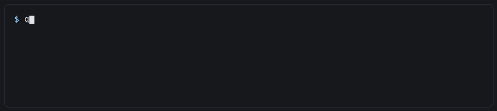
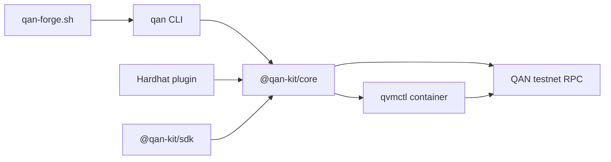

# qan-kit

[](https://github.com/panditdhamdhere/qan-kit/actions/workflows/ci.yml)
[](./LICENSE)
[](./package.json)

Deploy to [QAN testnet](https://docs.qanplatform.com/testnet) (chain id 1121) without hand-writing `docker run` lines. Solidity goes through `qvmctl` as one flattened file. QVM contracts get their storage slots declared, because an undeclared read comes back empty and does not revert.



## Install

`qan-kit` is not on npm yet. Clone the repo and build the `qan` binary:

```bash
git clone https://github.com/panditdhamdhere/qan-kit.git
cd qan-kit
pnpm install
pnpm build
pnpm --filter qan-kit exec qan --help
```

You need Docker, Node 20 or newer, and pnpm 10. On Apple Silicon the qvmctl image is amd64-only, so the config asks for `--platform linux/amd64`.

## Three commands

```bash
qan init --template solidity
qan doctor
qan deploy contracts/Counter.sol --name Counter
```

Put the key in `QAN_PRIVATE_KEY` (see `.env.example`). Fund it at https://faucet.qanplatform.com. The deploy writes `deployments/qan-testnet/Counter.json` and prints a QANscan link.

## Layout



| Piece                       | What it does                                                  |
| --------------------------- | ------------------------------------------------------------- |
| `@qan-kit/chains`           | viem chain and an ethers network for testnet. Mainnet throws. |
| `@qan-kit/core`             | Docker runner, flattener, slot scanner, config, deploy        |
| `qan-kit`                   | The `qan` binary                                              |
| `@qan-kit/hardhat`          | `qan` network and `hardhat qan:deploy`                        |
| `@qan-kit/sdk`              | Clients, deploy helper, XLINK stub                            |
| `foundry/qan-forge.sh`      | `forge build`, `forge flatten`, `qan deploy`                  |
| `action/`                   | GitHub Action, cached qvmctl image                            |
| `examples/solidity-counter` | A one-file Counter for `qan deploy`                           |
| `examples/go-counter`       | QVM counter that needs `-r COUNTER`                           |
| `examples/notary-dapp`      | Hash files, anchor the Merkle root                            |

Guides live in `docs/`. The flags we actually saw on `qvmctl` v0.1.0 are in `docs/ASSUMPTIONS.md`. If something was not in the help text, it is config, not a guess.

## Contributing

```bash
pnpm install
pnpm lint && pnpm typecheck && pnpm test && pnpm build
```

Node 20 or newer. Commits are conventional (`feat(cli): ...`) and small. Do not commit a private key, a `.env`, or a deployment that was signed with a real key. Do not enable mainnet. Live RPC tests stay behind `QAN_LIVE=1`.

If you hit a rough edge while deploying, add a row to `docs/DX-AUDIT.md`.

## License

MIT. See [LICENSE](./LICENSE).
